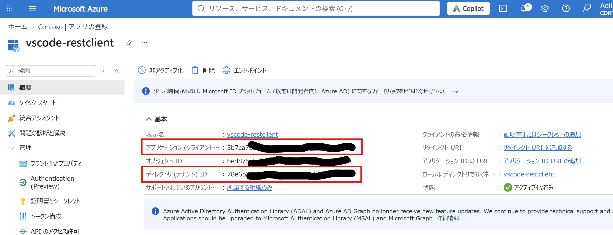
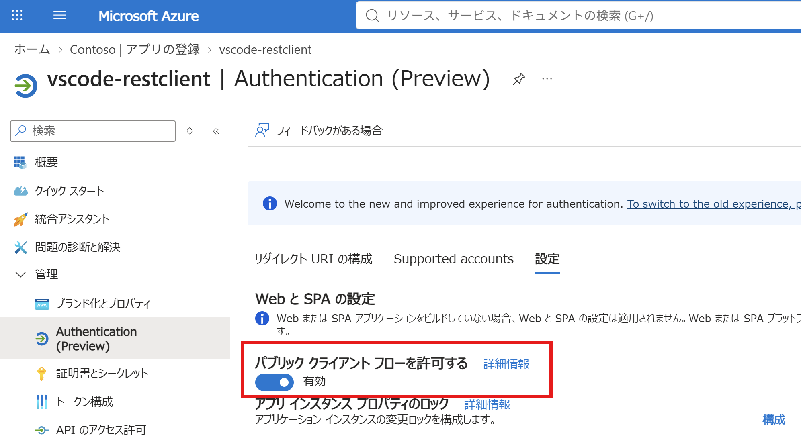
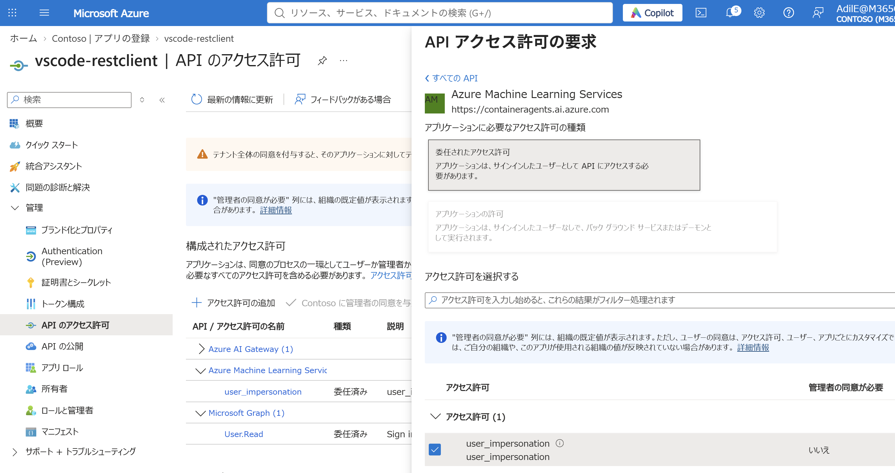
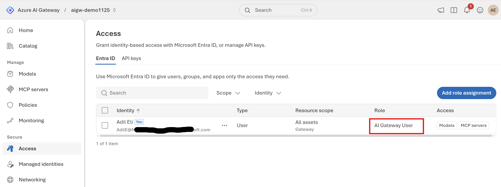
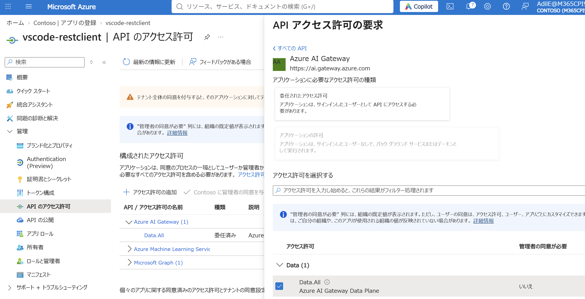

## はじめに

Microsoft Foundry などの Agent や Model を呼び出す疎通確認をしようとしていたのですが、
久しぶりだったせいかいろいろ忘れてたこともあるので備忘録としての記事になります。
まあ昨今は AI が手伝ってくれるんですけれども、ネットワーク制限が厳しめの閉域環境でやってたりすると Copilot が使えなかったりするので。

ということで [Visual Studio Code REST Client](https://marketplace.visualstudio.com/items?itemName=humao.rest-client) を使用する形でいくつか記述していきます。

## Microsoft Foundry にデプロイしたモデルやエージェントを呼び出す場合

さて、まずは Foundry を直接使っていきます。

### Foundry Model を Chat Completions API で呼び出すには

まずはシンプルに Chat Completions API で呼び出していきます。

```http
# Microsoft Foundry のリソース名
@foundry_name = your-foundry-resource-name
# デプロイしたモデルインスタンスの名前（モデル名そのものではない）
@model_deployment_name = gpt-5

POST https://{{foundry_name}}.services.ai.azure.com/openai/v1/chat/completions
Content-Type: application/json
Authorization: Bearer {{$dotenv FOUNDRY_ACCESS_TOKEN}}

{
  "model": "{{model_deployment_name}}",
  "messages": [
    {
      "role": "user",
      "content": "こんにちは。簡単に自己紹介してください。"
    }
  ]
}
```

ここでは Entra ID 認証用のアクセストークンは `.env` ファイルに記述しています。
アクセストークンの取得は以下のようになります。

```powershell
# Foundry Users ロールのユーザーで az login してから
az account get-access-token --scope 'https://ai.azure.com/.default' --query accessToken --output tsv
```

### アクセストークンを動的に取得したい

コマンドで取得したアクセストークンは 1 時間で有効期限が切れてしまうため、時折更新してやる必要があって厄介です。
なので REST Client から直接取得できるようにしておくと良いでしょう。

まず最初に Entra ID にアプリケーションを登録しておき、`テナント ID` と `クライアント ID` を控えておきます。



アプリを登録したらパブリック クライアント フローを有効にしておきます。



またそのアプリがユーザーの代理として `https://ai.azure.com/.default` スコープのアクセストークンを取得できるように委任設定を行います。
これちょっと探しにくいのですが、アクセス許可の追加時に `所属する組織で使用している API` タブで `18a66f5f-dbdf-4c17-9dd7-1634712a9cbe` を検索すると良いです。
名前が `Azure Machine Learning Services` となっていますが、間違っているわけではありません。
`user_impersonation` のアクセス許可を追加しておきましょう。



あとは `Authorization` ヘッダーで以下のようにアクセストークンを設定してやればよいわけです。
テナント ID とクライアント ID は先ほど控えておいた GUID 値になります。

> {{$aadV2Token scopes:https://ai.azure.com/.default tenantId:your-tenant-id clientId:your-client-id}}

最初はデバイスコード認証のようなログインを求められますので、Foundry Users ロールのユーザーでログインしましょう。

### Foundry Model を Responses API で呼び出すには

Responses API で呼び出す場合も URL と Body 構造が異なる程度の違いになります。

```http
@foundry_name = your-foundry-resource-name
@model_deployment_name = gpt-5

POST https://{{foundry_name}}.services.ai.azure.com/openai/v1/responses
Content-Type: application/json
Authorization: Bearer {{foundry_access_token}}

{
  "model": "{{model_deployment_name}}",
  "input": "こんにちは。簡単に自己紹介してください。"
}
```

日本語の返答は UTF エンコードがかかっていて読みにくいので、`.vscode/settings.json` に以下のように記載しておくと良いでしょう。

```json
{
    "rest-client.decodeEscapedUnicodeCharacters": true
}
```

### Foundry Agent を Responses API で呼び出すには

モデルが Responses API で呼び出せたので、同様にエージェントを呼び出すことも可能です。

```http
@foundry_name = your-foundry-name
@project_name = your-project-name
@agent_name = your-agent-name
@api_version = 2025-11-15-preview

POST https://{{foundry_name}}.services.ai.azure.com/api/projects/{{project_name}}/agents/{{agent_name}}/endpoint/protocols/openai/responses?api-version={{api_version}}
Content-Type: application/json
Authorization: Bearer {{$dotenv FOUNDRY_ACCESS_TOKEN}}

{
  "input": "こんにちは。簡単に自己紹介してください。"
}
```

同じ Responses API プロトコルなのですがモデルの場合と以下が異なります。

- モデル用の `/openai/v1/responses` とは異なり、このエージェントのエンドポイントでは `api-version` クエリパラメーターが必要
- 要求データのボディでモデル デプロイメント名を指定しない（URL パスにエージェント名が含まれているため）

## AI Gateway 経由で Foundry Model を呼び出す場合

さて実はこれがもともとのきっかけだったのですが、先日（2026 年 11 月 17 日）に 
[Azure AI Gateway が GA](https://techcommunity.microsoft.com/blog/integrationsonazureblog/azure-ai-gateway-is-now-generally-available-ship-faster-stay-in-control/4572644) しました。
なので AI Gateway 経由で Foundry Model を呼び出すことを考えます。
構成方法などに関しては下記の公式ドキュメント等をご参照ください。製品内ドキュメントと言いつつ AI Gateway がなくても Azure アカウントがなくてもドキュメント自体は参照可能です。

- [Microsoft Learn](https://learn.microsoft.com/ja-jp/azure/ai-gateway/overview)
- [製品内ドキュメント](https://ai.gateway.azure.com/docs)

AI Gateway インスタンスを作成したらモデルを追加してあげます。
この時にポイントになるのが `alias` です。
AI Gateway はこの[エイリアス](https://ai.gateway.azure.com/docs/models/aliases)を元に
受信したリクエストの転送先となるプロバイダーとモデルを選定しています。
Foundry モデルを追加した場合、既定の設定では `foundry-resource-name/model-deployment-name` のような名前が付けられます。
つまり AI Gateway を呼び出すときは、モデルデプロイメント名ではなくこのエイリアスを指定することになります。

### AI Gateway を Responses API 呼び出すには

プロトコルそのものは Foundry を呼び出すときと変わらないのですが、いくつか注意点があります。

- エンドポイントは AI Gateway のポータル画面 https://ai.gateway.azure.com でモデルを選択すると確認できます。
- モデルデプロイ名ではなく、AI Gateway に登録したモデルのエイリアスを使用する
- Entra ID 認証を使用する場合には `Access` 画面で使用するユーザーに対してロールを割り当てておく（下図）



必要なアクセストークンのスコープは `https://ai.gateway.azure.com/Data.Al` になりますので、以下のコマンドで取得して `.env` に記載しておきます。

```powershell
# AI Gateway Users 等のロールのユーザーで az login してから
az account get-access-token --scope 'https://ai.gateway.azure.com/Data.Al' --query accessToken --output tsv
```

実際に呼び出すときは以下のような形になります。

```http
@ai_gateway = your-ai-gateway-name
@model_alias = your/alias

POST https://{{ai_gateway}}.japaneast-01.ai.gateway.azure.com/default/models/openai/v1/responses
Content-Type: application/json
Authorization: Bearer {{$dotenv AIGW_ACCESS_TOKEN}}

{
  "model": "{{model_alias}}",
  "input": "こんにちは。簡単に自己紹介してください。"
}
```

### REST Client で AI Gateway のアクセストークンを取得するには

アクセスを委任したい API とスコープが Foundry と AI Gateway では異なりますので、委任設定を別途行う必要があります。
AI Gateway を表すアプリケーション ID は `18550318-e177-4205-a743-6816d6fcdc3f` なのでこれを検索すればいいのですが、初期状態ではこのアプリが登録されていないため見つかりません。
見つからない場合には管理者に依頼してアプリケーションを登録してもらう必要があります。

```powershell
az ad sp create --id '18550318-e177-4205-a743-6816d6fcdc3f'
```

上記が終わったら REST Client で使用するアプリ登録に対して委任を設定します。



アクセストークンは以下のように取得できます。

> {{$aadV2Token scopes:https://ai.gateway.azure.com/Data.All tenantId:your-tenant-id clientId:your-client-id}}

## まとめ

備忘録なのでまとめるものもないのですが、参考になれば幸いです。